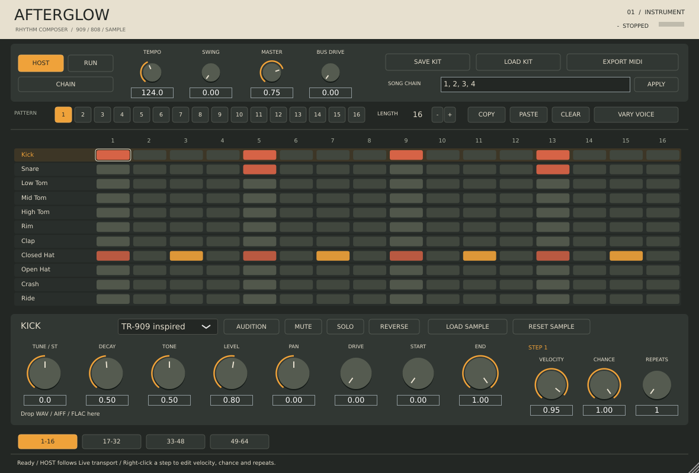

# Afterglow

A ReBirth-inspired drum-machine **VST3 instrument for Windows x64**, built for pattern programming in Ableton Live. Default 909-inspired kit; switch each voice to 808-inspired synthesis or your own sample. Original interface and branding; no Roland ROMs or ReBirth assets.

**Version 0.1.0 — initial development build.** Read `docs/VALIDATION.md` for exactly what was built and tested. Hardware matching and operation inside Ableton Live must not be assumed from unit tests.

Download the Windows build from [GitHub Releases](https://github.com/sbrunwas/afterglow/releases). Choose **Afterglow-Windows-x64.zip**; source-only archives do not contain the plugin binary.



## Install in Ableton Live on Windows

1. Extract the Windows ZIP. Copy the **entire `Afterglow.vst3` folder** into `C:\Program Files\Common Files\VST3\` (administrator permission may be needed). Do not extract or copy only its inner binary.
2. In Live, open **Settings → Plug-Ins**, enable **Use VST3 Plug-In System Folders**, and rescan. Alternatively select a custom VST3 folder and put the whole bundle there.
3. Drag **Afterglow** onto a MIDI track. Press Live's Play button. **HOST** is enabled by default and follows Live's tempo and position.
4. For independent auditioning, turn HOST off and RUN on. For playing only from MIDI, turn both HOST and RUN off. The internal sequencer and incoming MIDI can play together.

`Afterglow.exe` is the optional standalone version. Select your audio device, disable HOST and enable RUN. No separate DAW is required for this mode.

## Compose

- **16 patterns**, each **1–64 sixteenth-note steps**, displayed in four 16-step pages.
- Click a grid key to toggle. **Right-click a key** to select it without toggling. Edit **velocity, chance, and 1–4 repeats** in the step inspector.
- Click an instrument name for its controls; right-click its name to audition it.
- Per voice: **909 / 808 / Sample**, tune ±24 semitones, decay, tone, level, pan, drive, mute and solo.
- **Swing** delays alternating steps. Repeats follow the swung spacing.
- **COPY / PASTE**, pattern clear, and **VARY VOICE** for a random variation of the selected instrument.
- Enter a chain such as `1, 1, 2, 4`, click APPLY, then enable CHAIN. Chains support up to 64 entries and honor each pattern's length.
- **SAVE KIT / LOAD KIT** saves all 16 patterns, chain, controls, and embedded samples in a `.afterglow` file. Live project state also embeds the samples, so moving the original WAV does not break recall.
- **EXPORT MIDI** writes the selected pattern with swing, velocities and repeats. It includes enabled steps with nonzero probability; it does **not** bake a particular probabilistic performance or export the whole song chain.

The sequencer follows the absolute host beat position. Starting playback midway through a pattern waits for the next scheduled event rather than restarting at step 1. See `docs/SEQUENCER.md`.

## Samples

Select a voice and drag one **WAV, AIFF, or FLAC** into the editor, or use LOAD SAMPLE. Files must be at most **10 seconds**, 8–192 kHz. Mono and stereo are supported (the first two channels of multichannel files are used).

Loading automatically selects Sample mode. Tune changes playback speed/pitch; START / END trim the playback region and REVERSE reverses it. Sample playback is one-shot, with no time stretching. Synth decay/tone are synth controls; they do not act as sample filters. RESET SAMPLE removes the data; choose 909 or 808 to resume synthesized sound.

## MIDI and separate outputs

All input MIDI channels are accepted. Notes use the following numbers; octave names vary between hosts.

| Note | Voice | Output bus |
|---:|---|---|
| 36 | Kick | Kick |
| 38 | Snare | Snare |
| 41 | Low Tom | Low Tom |
| 45 | Mid Tom | Mid Tom |
| 48 | High Tom | High Tom |
| 37 | Rim | Rim |
| 39 | Clap | Clap |
| 42 | Closed Hat | Closed Hat |
| 46 | Open Hat | Open Hat |
| 49 | Crash | Crash |
| 51 | Ride | Ride |

The plugin provides stereo Master plus 11 optional stereo voice buses. In Live, add audio tracks and choose Afterglow's track and the desired plug-in output in Audio From. Individual buses include voice level/pan/drive/mute/solo but bypass Master level/drive. All voices remain in Master as well; avoid monitoring both routes unintentionally. Closed hat chokes open hat.

## Sound and fidelity

The 808/909 kick and snare engines build on MIT-licensed **DaisySP / Mutable Instruments Plaits** drum models. Additional percussion is original procedural DSP. These are **inspired models, not a measured circuit-identical emulation**. The original 909 used sampled cymbals; our stock 909 hats/crash/ride are synthesized approximations. Load recordings you own into those slots if exact sampled cymbal character is important. No hardware comparison has been completed.

See `docs/DSP.md`, `docs/ARCHITECTURE.md`, and `THIRD_PARTY_NOTICES.md` for provenance and limitations.

## Build

Requires CMake ≥3.22, a C++17 compiler, and Git. JUCE 8.0.6 is fetched on configure, or pass `-DAFTERGLOW_JUCE_PATH=/path/to/JUCE`. The DSP dependency subset is vendored.

Windows, from a Visual Studio 2022 developer terminal:

```powershell
cmake -S . -B build -A x64 -DCMAKE_BUILD_TYPE=Release
cmake --build build --config Release --parallel 2
ctest --test-dir build -C Release --output-on-failure
```

Build products are under `build/Afterglow_artefacts/Release/VST3/` and `.../Standalone/`. See `.github/workflows/build.yml` for automated Windows builds and release packaging.

Core tests without JUCE or GUI dependencies:

```sh
cmake -S . -B build-core -DAFTERGLOW_BUILD_PLUGIN=OFF
cmake --build build-core
ctest --test-dir build-core --output-on-failure
```

## License

Project code is **AGPL-3.0-only**; third-party components keep their respective licenses. JUCE's open-source AGPL route is used. Bundled VST3 SDK licensing and DaisySP MIT notices are documented in `THIRD_PARTY_NOTICES.md`. This is an independent project with no affiliation with Roland, Propellerhead/Reason Studios, or Ableton.
